<div align="center">
  <picture>
    <source media="(prefers-color-scheme: dark)" srcset="docs/assets/logo-wordmark-dark.png" />
    <source media="(prefers-color-scheme: light)" srcset="docs/assets/logo-wordmark-light.png" />
    
  </picture>

  <h1>NexaMarket AI</h1>

  <p>
    <a href="#see-how-it-works">Recorridos en Video</a> ·
    <a href="#dark--light-mode">Modo Oscuro & Claro</a> ·
    <a href="#whats-inside">Galería Visual</a> ·
    <a href="#download--get-started">Descargar & Empezar</a> ·
    <a href="#architecture--developer-guide">Arquitectura & Ingeniería</a>
  </p>

  <p><b>Marketplace multi-vendedor inteligente con cobros protegidos por Mercado Pago, consola ejecutiva en tiempo real y asistente de compras con IA.</b></p>
  <p>Una plataforma completa, rápida y 100% auto-alojada donde múltiples tiendas oficiales venden bajo una identidad unificada, con inventario reservado al instante, reseñas de compras verificadas y gobierno centralizado.</p>

  <p>
    
    
    
    
    
    
    
    
  </p>

  <p>
    <a href="#download--get-started"></a>
    <a href="#see-how-it-works"></a>
  </p>

  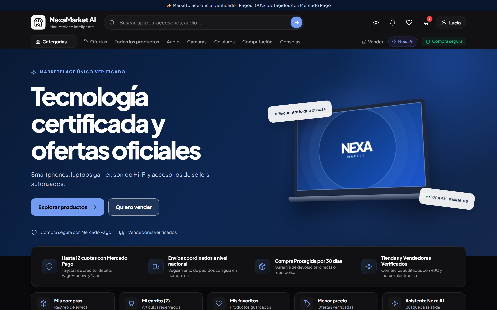
  <p><sub>Tienda oficial NexaMarket AI en Modo Oscuro: buscador inteligente con sugerencias instantáneas, navegación por departamentos, acceso directo al carrito y beneficios de compra protegida con Mercado Pago.</sub></p>
</div>

> [!NOTE]
> **Control total de tus datos y pagos (`v0.1.0-beta`):** NexaMarket AI se ejecuta íntegramente en tu propia infraestructura con Docker Compose y PostgreSQL 16. Ningún dato de tarjeta bancaria pasa ni se almacena en la plataforma: cada pago se procesa directamente con Mercado Pago bajo estándar PCI-DSS.

---

## Por Qué los Equipos Eligen NexaMarket AI

- **Una sola tienda oficial, múltiples vendedores verificados:** Los compradores disfrutan de una experiencia visual coherente y rápida en toda la plataforma, mientras el administrador central gobierna el diseño, las categorías y las comisiones desde un solo panel.
- **Pagos transparentes con Mercado Pago (1 pago por vendedor):** Si un cliente agrega productos de varias tiendas en el mismo carrito, el sistema organiza automáticamente un subpedido independiente por cada vendedor con su propio cobro seguro y seguimiento de envío.
- **Consola ejecutiva Back-Office lista para operar:** Incluye barra lateral colapsable (`<aside>`), menú Hamburguesa (`☰`), gráficos interactivos de ingresos en Soles (`GMV`), estado de órdenes en tiempo real, directorio de cuentas de usuario con fotografías de perfil y auditoría completa.
- **Asistente de compras Nexa AI seguro por diseño:** Ayuda a los clientes a descubrir y comparar productos del catálogo usando lenguaje natural, sin tener acceso jamás a tarjetas, contraseñas ni ejecución de cobros.

---

## See How It Works

### 1. Experiencia de Compra, Cambio de Tema en Vivo y Reseñas Verificadas

En este recorrido interactivo puedes ver:
1. La tienda principal en **Modo Oscuro** con el logotipo oficial adaptable.
2. El cambio instantáneo a **Modo Claro** con un solo clic en la barra superior (observa cómo el logo y todas las tarjetas se adaptan al instante).
3. El regreso a **Modo Oscuro** y la apertura de la ficha de un **Apple iPhone 16 Pro Max 256GB Titanio**.
4. El desplazamiento hacia la sección **Opiniones de compradores**, donde se visualiza la calificación `4.9★`, las barras de distribución por estrellas y las reseñas reales con insignia de *Compra verificada*.

<div align="center">
  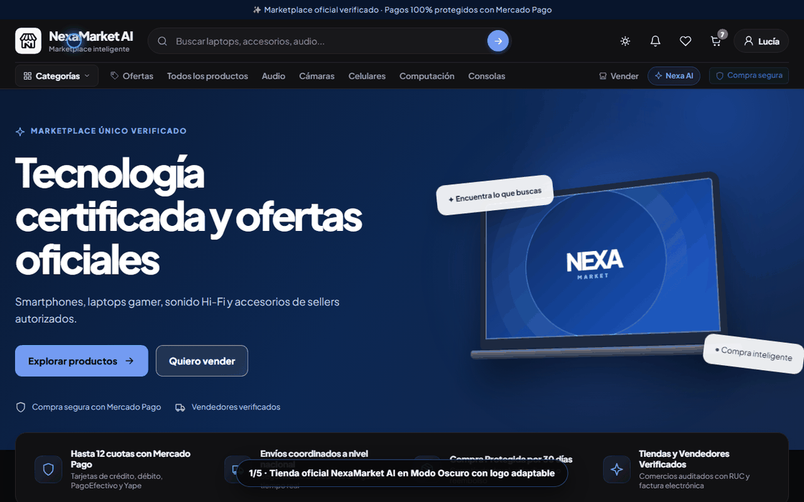
  <p><sub>Demostración en vivo: alternancia entre Modo Oscuro y Modo Claro, inspección de producto y lectura de opiniones verificadas (<a href="docs/assets/videos/demo-shopping-and-reviews.webm">ver video HD .webm</a>).</sub></p>
</div>

---

### 2. Consola Ejecutiva de Administración, Gráficos Dinámicos y Cuentas de Usuario

En este recorrido por el panel administrativo (`/admin` y `/dashboard`):
1. Revisamos el **Volumen de Ventas (GMV en Soles)** y los 4 indicadores clave en la fila superior (`Solicitudes KYB`, `Órdenes globales`, `Comisión activa` y `Eventos de auditoría`).
2. Cambiamos el filtro temporal del gráfico a **1 Año** para consultar la curva acumulada de ventas (`S/ 913,100`) y el ticket promedio.
3. Inspeccionamos el gráfico circular de **Distribución de Órdenes** y el gráfico de barras de **Adquisición de Compradores y Sellers**.
4. Entramos desde el menú lateral (`<aside>`) a **Cuentas de usuario** para revisar los perfiles registrados con sus fotos de perfil, roles (`ADMINISTRADOR`, `SELLER PRO`, `COMPRADOR`) y órdenes asociadas.
5. Pulsamos el botón **Hamburguesa (`☰`)** para contraer la barra lateral y maximizar el espacio de trabajo.

<div align="center">
  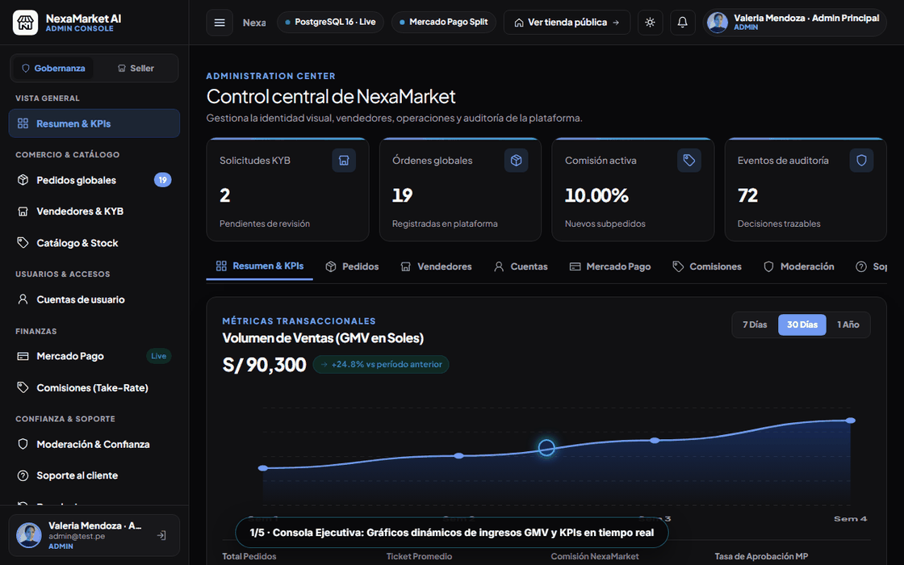
  <p><sub>Consola Back-Office en acción: gráficos interactivos de ventas, distribución de pedidos, directorio de usuarios con avatar y barra lateral colapsable (<a href="docs/assets/videos/demo-admin-console-and-charts.webm">ver video HD .webm</a>).</sub></p>
</div>

---

### 3. Portal de Vendedores (Seller Center) y Asistente Inteligente Nexa AI

En este tercer clip vemos:
1. El **Seller Center (`/seller`)**, donde cada comercio gestiona su vinculación con Mercado Pago y revisa sus indicadores de inventario.
2. La pestaña de **Métricas de Venta** y control de publicaciones activas.
3. El **Asistente Nexa AI (`/ai`)**, respondiendo consultas de catálogo al instante con productos en stock real.

<div align="center">
  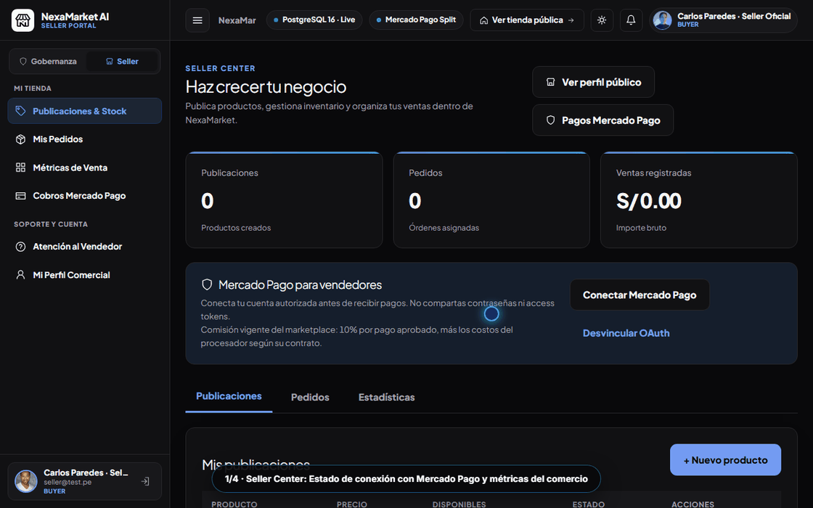
  <p><sub>Gestión comercial en el Seller Center y recomendaciones conversacionales en vivo con Nexa AI (<a href="docs/assets/videos/demo-seller-and-ai-assistant.webm">ver video HD .webm</a>).</sub></p>
</div>

---

## Dark & Light Mode

Tanto la aplicación web como el logotipo oficial de **NexaMarket AI** están diseñados para verse nítidos y con contraste perfecto en **Modo Oscuro** y **Modo Claro**:

| Modo Oscuro (`Dark Mode`) | Modo Claro (`Light Mode`) |
| :---: | :---: |
|  | 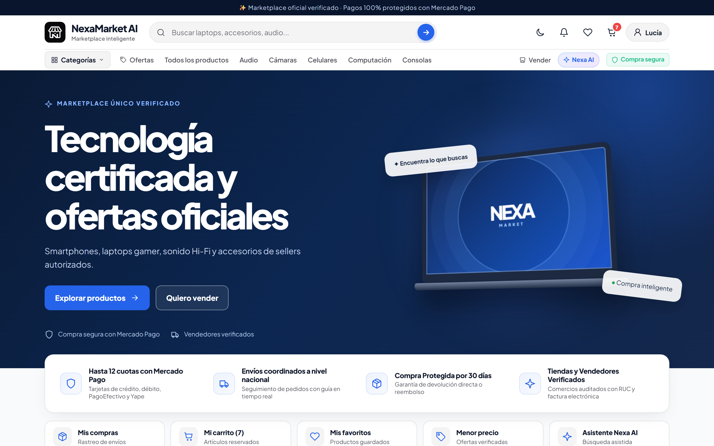 |
| <sub>Superficies oscuras de alto contraste con icono claro adaptable.</sub> | <sub>Superficies limpias y luminosas con icono oscuro de alta legibilidad.</sub> |

---

## What's Inside

| Catálogo Multi-Categoría y Filtros (`/search`) | Opiniones de Compradores Verificados (`/products/:id`) |
| :---: | :---: |
| 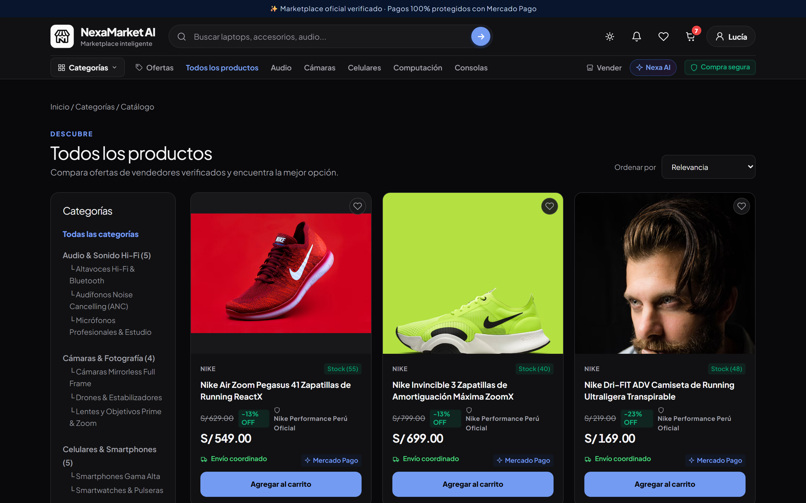 | 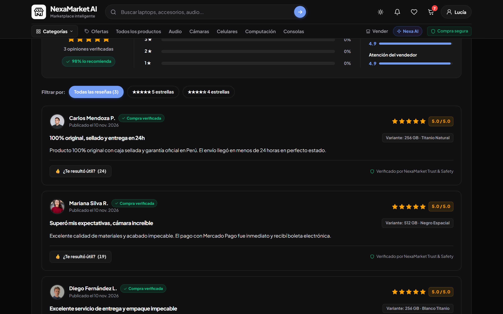 |
| <sub>Búsqueda instantánea con filtros por departamento, ordenamiento por precio, etiquetas de descuento (`-9% OFF`) e indicadores de stock disponible.</sub> | <sub>Resumen de calificación `4.9★`, barras de porcentaje por estrellas, métricas de calidad/envío y tarjetas de clientes con foto de perfil e insignia de *Compra verificada*.</sub> |

| Carrito Multi-Vendedor con Pago Separado (`/cart`) | Portal de Vendedores — Seller Center (`/seller`) |
| :---: | :---: |
| 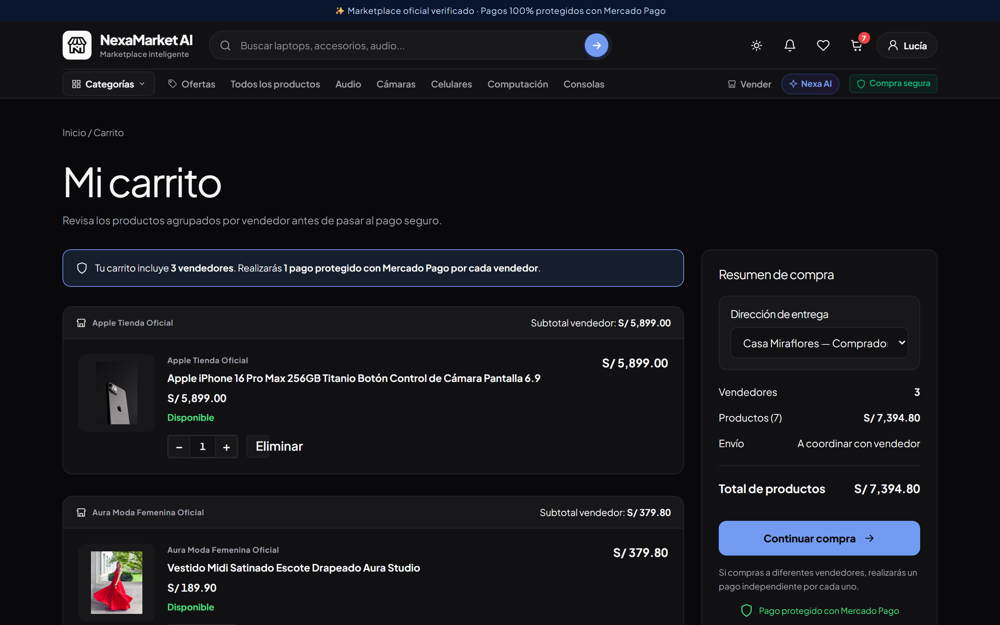 | 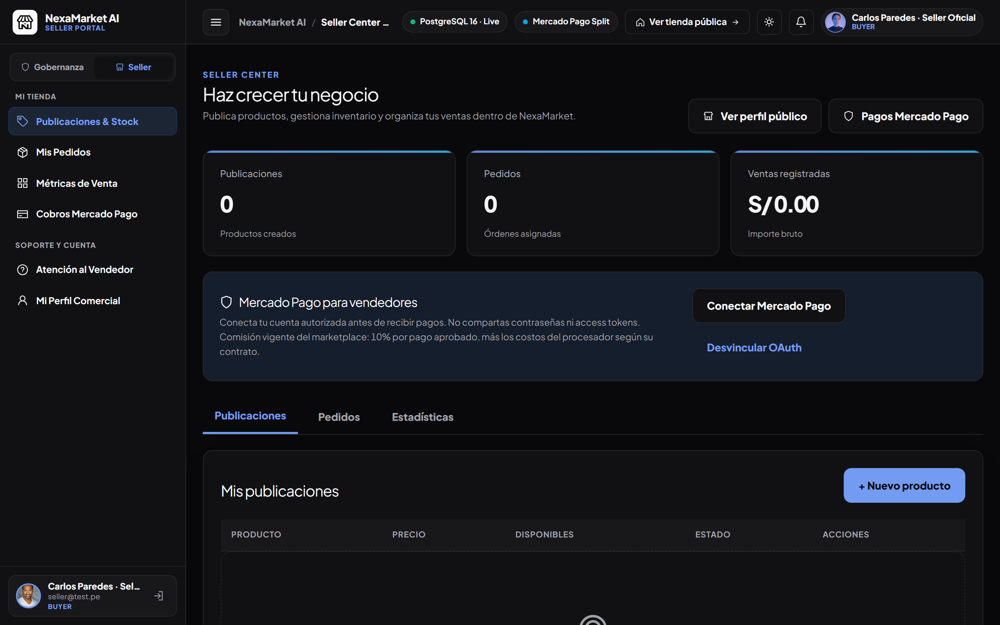 |
| <sub>Agrupación automática de artículos por tienda (`Apple Tienda Oficial`, `Aura Moda Femenina Oficial`) informando con claridad que se realizará 1 pago protegido por cada vendedor.</sub> | <sub>Panel exclusivo para comercios con barra lateral propia, estado de cuenta Mercado Pago, catálogo de productos publicados, stock reservado y creación rápida de publicaciones.</sub> |

| Consola Ejecutiva y Gráficos (`/admin`) | Directorio de Usuarios y Roles (`/admin/users`) |
| :---: | :---: |
| 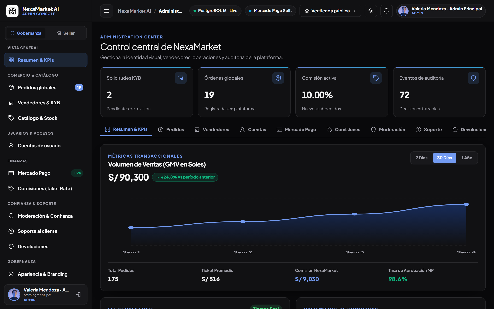 | 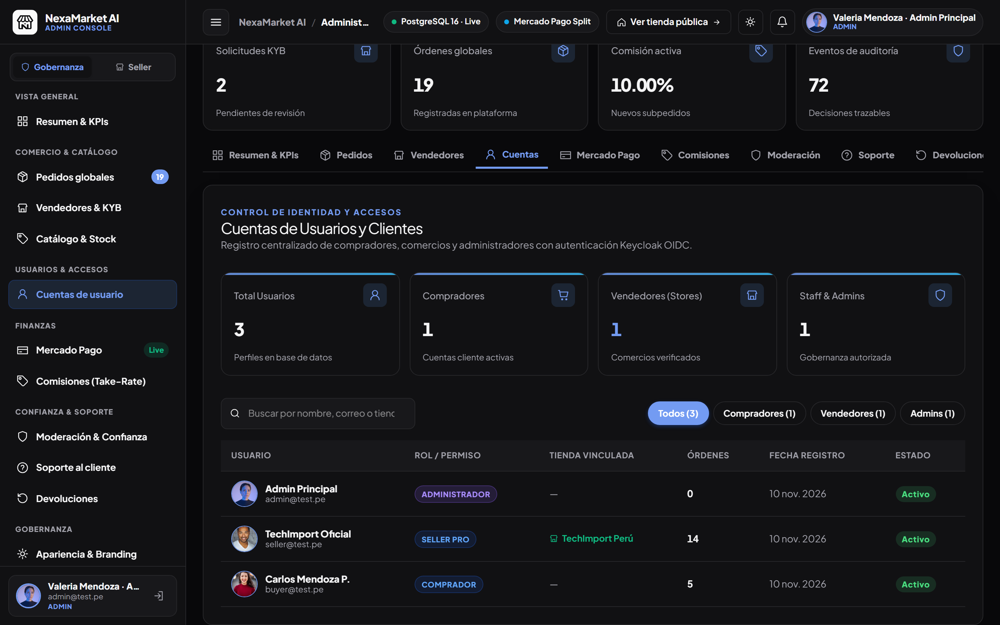 |
| <sub>Vista general de administración con barra lateral `<aside>`, estado de PostgreSQL 16 en vivo, 4 tarjetas KPI superiores y curva interactiva de Volumen de Ventas en Soles (`S/ 90,300`).</sub> | <sub>Gestión centralizada de cuentas con buscador en vivo, filtros por tipo de usuario (`Compradores`, `Vendedores`, `Admins`), fotografías de perfil y conteo de compras.</sub> |

<div align="center">
  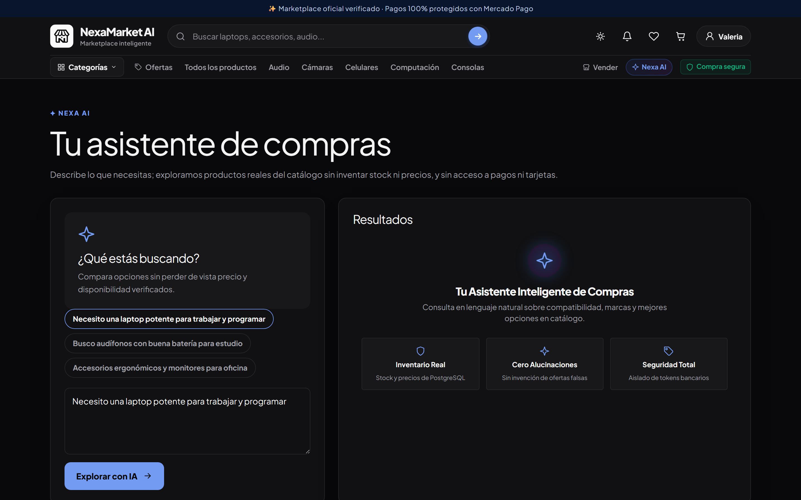
  <p><sub><b>Asistente Nexa AI (`/ai`):</b> Descubre laptops, celulares, moda y equipamiento deportivo mediante sugerencias rápidas o preguntas abiertas, siempre respaldado por el stock real del catálogo.</sub></p>
</div>

---

## Download & Get Started

**Versión actual:** `0.1.0-beta` ([Leer el Changelog completo](CHANGELOG.md) · [Guía de Release](docs/GITHUB_RELEASE_0.1.0-beta.md))

### Paso 1 — Descargar `v0.1.0-beta`

- **Opción A — Descarga directa desde GitHub:** Haz clic en el botón verde **Code → Download ZIP** arriba a la derecha, o descarga el paquete **`v0.1.0-beta`** desde la sección **Releases**.
- **Opción B — Clonar con Git:**
  ```bash
  git clone --branch v0.1.0-beta https://github.com/VigilioYonatan/nexamarket-ai-platform.git
  cd nexamarket-ai-platform
  ```

### Paso 2 — Iniciar la Plataforma

1. Copia el archivo de configuración de ejemplo:
   ```bash
   cp .env.example .env
   ```
2. Levanta los servicios de infraestructura (PostgreSQL 16, Keycloak, SeaweedFS y observabilidad) con Docker Compose:
   ```bash
   docker compose -f infra/compose/docker-compose.yml --env-file .env up -d
   ```
3. Instala las dependencias e inicia la API y la aplicación web:
   ```bash
   npm install
   npm run dev:api
   npm run dev:web
   ```
4. Abre tu navegador en **`http://localhost:5175`**:
   - En `/login` dispones de botones de **Acceso Rápido en 1 Clic** para probar de inmediato los tres perfiles (**Comprador Oficial**, **Vendedor Oficial** y **Administrador**).

---

<details id="architecture--developer-guide">
<summary><b>🛠️ Arquitectura, Estructura del Monorepo y Guía para Desarrolladores (Haz clic para desplegar)</b></summary>

<br />

### 1. Stack Tecnológico Principal

| Capa | Tecnología | Propósito |
| :--- | :--- | :--- |
| **Frontend Web** | Preact 10 + `@preact/signals` + Vite 7 | Storefront accesible, Seller Center y Consola Ejecutiva Back-Office con soporte nativo Dark/Light. |
| **Backend API** | NestJS 11 + TypeScript 5.9 + Zod | API modular con validación estricta en frontera HTTP, control de acceso por rol/recurso y OpenAPI. |
| **Base de Datos** | PostgreSQL 16 + Drizzle ORM | Fuente única de verdad transaccional para catálogo, inventario, órdenes, pagos y auditoría. |
| **Identidad & Auth** | Keycloak 26 (OIDC + PKCE) | Autenticación centralizada con sesiones seguras en servidor y cookies `HttpOnly`. |
| **Pagos** | Mercado Pago Official Integration | Creación de preferencias de pago por subpedido (`1:1` por vendedor) y conciliación de webhooks. |
| **Almacenamiento** | SeaweedFS | Almacenamiento auto-alojado de imágenes de productos, avatares y activos de marca en formato WebP. |
| **Servicio IA** | FastAPI (Python 3.12) | Asistente conversacional de consulta de catálogo aislado de operaciones financieras. |

---

### 2. Diagrama de Arquitectura

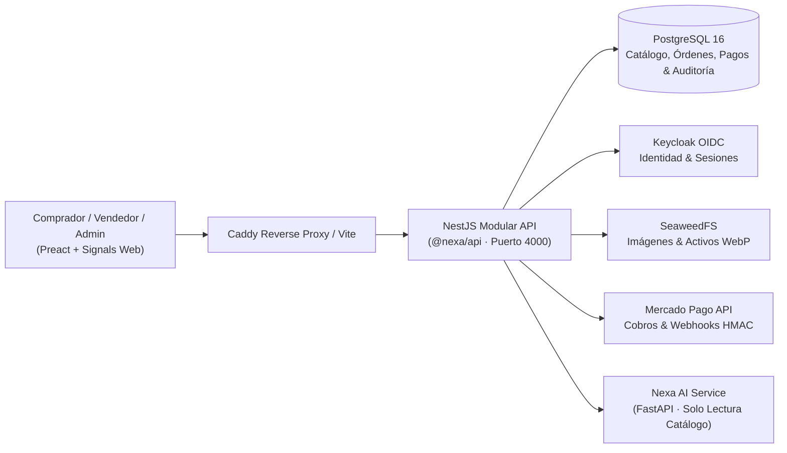

---

### 3. Estructura del Repositorio

```text
nexamarket-ai-platform/
├── apps/
│   ├── api/                  # Backend modular NestJS (Auth, Catalog, Cart, Orders, Payments, Admin, Seller)
│   ├── web/                  # Aplicación web Preact + Signals (Storefront, Seller Center y Admin Console)
│   └── ai/                   # Microservicio Python FastAPI para recomendaciones de catálogo
├── packages/
│   └── domain/               # Reglas de negocio puras, máquinas de estado de órdenes y cálculo de comisiones
├── infra/
│   ├── compose/              # Definición de servicios Docker Compose auto-alojados
│   ├── postgres/             # Migraciones SQL numeradas (0001..0004) y scripts de respaldo/restauración
│   └── keycloak/             # Configuración del realm OIDC
├── scripts/                  # Super Seeders, poblado de catálogo real y pipeline Playwright de capturas/videos
├── tests/                    # Pruebas BDD (Cucumber) y suites E2E (Playwright)
├── docs/                     # Blueprint de producto, matriz de trazabilidad, ADRs y activos visuales
├── VERSION                   # Fuente única de versión semántica (0.1.0-beta)
└── CHANGELOG.md              # Historial detallado de versiones
```

---

### 4. Variables de Entorno Principales (`.env.example`)

| Variable | Requerida | Valor por Defecto (Dev) | Descripción |
| :--- | :---: | :--- | :--- |
| `DATABASE_URL` | Sí | `postgresql://...` | Cadena de conexión a PostgreSQL 16. |
| `SESSION_SECRET` | Sí | *(32+ caracteres)* | Secreto para firma de sesiones en servidor. |
| `KEYCLOAK_ISSUER_URL` | Sí | `http://localhost:8080/realms/nexamarket` | Emisor OIDC para validación de tokens. |
| `MP_ACCESS_TOKEN` | Sí | *(Token sandbox/prod)* | Credencial privada de servidor para Mercado Pago. |
| `MP_WEBHOOK_SECRET` | Sí | *(Secreto HMAC)* | Clave de verificación de firma para notificaciones de pago. |
| `SEAWEED_FILER_URL` | Sí | `http://localhost:8888` | Endpoint interno para almacenamiento de imágenes optimizadas. |

---

### 5. Comandos de Verificación, Super Seeder y Pruebas

```bash
# Poblar / refrescar el Super Seeder con usuarios, avatares y catálogo completo
node scripts/enrich_super_seed.mjs

# Verificar tipado estricto y formato con Biome
npm run typecheck
npm run lint

# Ejecutar pruebas de dominio, unitarias, BDD, integración y E2E
npm run test:domain
npm run test:unit
npm run test:bdd
npm run test:integration
npm run test:e2e

# Regenerar capturas Retina 2x y videos (.webm + .gif) del README
node scripts/capture_readme_showcase.mjs
python scripts/encode_showcase_gifs.py
```

</details>

---

## Preguntas Frecuentes (FAQ)

**¿Puedo cambiar el nombre, colores y logotipo del marketplace sin tocar el código?**
Sí. Desde la consola de administración (`/admin/appearance`) puedes modificar el nombre de la marca, colores principales, tipografía, radio de bordes, imágenes de categorías y publicar nuevas versiones del tema o volver a una versión anterior con un clic.

**¿Cómo funcionan los pagos cuando un cliente compra a varios vendedores a la vez?**
El carrito agrupa los productos por tienda y genera una orden dividida en subpedidos independientes (uno por cada vendedor). Así cada pago se procesa y concilia de forma transparente a través de Mercado Pago sin mezclar fondos entre distintos comercios.

**¿El asistente de IA puede realizar compras o ver tarjetas de los usuarios?**
No. Por diseño de seguridad, **Nexa AI** solo tiene permiso de lectura sobre el catálogo público de productos para responder preguntas y recomendar opciones. Nunca recibe datos financieros ni puede confirmar pagos.
